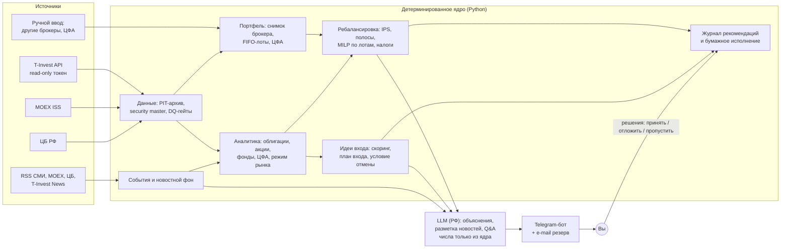

# investbot — обзор исследования и архитектуры

> 09.10.2026 · архитектура v1.3 · Личный ИИ-аналитик инвестиций для рынка РФ (Т-Инвестиции, MOEX, Telegram).
> **Это не инвестиционная рекомендация.** Здесь описан системный дизайн. Названия бумаг в документах приводятся только как примеры вызовов API или бенчмарки.

## Что где лежит

| Документ | Что внутри | Когда читать |
|---|---|---|
| **этот файл** | Выжимка: выводы, схема, решения, сроки, стоимость, что нужно от вас | Сначала |
| [ARCHITECTURE.md](ARCHITECTURE.md) | Итоговая архитектура и план реализации: 22 раздела, ADR, схемы, модель данных, движок ребалансировки, UX бота, расписание, стек, дорожная карта, риски, открытые вопросы | Перед стартом разработки |
| [RESEARCH.md](RESEARCH.md) | Сводный ресерч: как устроены финансовые ИИ-агенты, RL, существующие решения, T-Invest API, каталог источников данных, сентимент, специфика рынка РФ, право | Чтобы понять, почему решения именно такие |
| [research/01–11](research/) | 11 детальных отчётов с источниками. В конце каждого — таблица верификации ключевых утверждений | По конкретной теме |

**Как готовилось.** 11 тем исследовали параллельно. Затем отдельный агент-верификатор пытался опровергнуть ключевые утверждения каждого отчёта (110 проверок: 59 ✅ подтверждено, 37 ✏️ исправлено, 2 ❌ опровергнуто, 12 ❔ не удалось проверить). Три архитектора с разными приоритетами написали независимые проекты: MVP-first, качество аналитики, надёжность и риск-контроль. Их оценили три судьи: портфельный управляющий, архитектор, продакт. Победивший проект доработан с учётом лучших идей двух других и прошёл два раунда критики. Непроверенные факты помечены **[проверить]** и собраны в [Приложении B](ARCHITECTURE.md#приложение-b-исправленные-и-непроверенные-утверждения).

## Главные выводы ресерча

1. **Готового решения под ваш запрос нет.** Брокерские ИИ-ассистенты (Т, Сбер, Альфа, Финам) только отвечают на вопросы. Робо-эдвайзеры сами торгуют на отдельном счёте. Трекеры вроде Snowball не анализируют новости и не знают ЦФА. Open-source-боты под T-Invest обходятся без LLM. Подробнее: [RESEARCH §4](RESEARCH.md#4-существующие-решения-рф-и-мир).
2. **«LLM рассуждает, код считает».** Так устроены зрелые системы 2026 года (FinRobot V2, ai-hedge-fund, робот Т-Банка на n8n). Числам, которые выдаёт LLM, доверять нельзя. А опубликованные доходности LLM-трейдеров завышены из-за look-ahead: после даты отсечки знаний модели Sharpe падает на 51–62%.
3. **Полноценный DRL на MOEX не оправдан.** Простые бейзлайны (1/N, MinVar) DRL-аллокаторы обыгрывают с трудом. Недельной истории после 2022 года всего около 237 точек. RL уместен только в узких ролях и после накопления журнала рекомендаций.
4. **T-Invest API (контракты 1.51) закрывает почти всё для read-only агента:** портфель, операции, справочники, свечи, купоны и оферты, дивиденды, фундаментал, консенсус-прогнозы, ленту новостей `News`, рейтинги облигаций. Read-only токен — штатный тип. Пробелы: нет позиций и котировок ЦФА, нет состава фондов, нет истории фундаментала. SDK переехал: `t-tech-investments`, ставится только с GitLab-индекса Т-Банка.
5. **Данные для MVP бесплатны:** MOEX ISS (история, облигации, кривая КБД, индексы), ЦБ, T-Invest, RSS-ленты СМИ. RSS хранят всего 1–2 часа истории, поэтому свой архив новостей нужно копить с первого дня.
6. **Сентимент — слабый и в основном реактивный сигнал.** Русского «FinBERT» промышленного качества нет. События (дефолты, рейтинги, оферты, дивиденды) важнее тона. Поэтому сентимент работает как фильтр риска и источник алертов. Вес в скоринге он получит только после форвардной проверки.
7. **Инфраструктура и право.** Claude, OpenAI и Gemini Россию не обслуживают, поэтому LLM берутся у российских провайдеров (Cloud.ru, Yandex AI Studio, GigaChat). По рабочей гипотезе, Telegram в РФ доступен только через VPN **[проверить]**: бот живёт на VPS в РФ, к Telegram ходит через туннель, резервный канал — e-mail. Бот «для себя» не подпадает под инвестконсультирование (39-ФЗ). Если давать его другим людям, правовой режим меняется.

## Архитектура в одной схеме

Полная диаграмма компонентов и sequence-диаграммы недельного цикла — в [ARCHITECTURE §4](ARCHITECTURE.md#4-высокоуровневая-архитектура).

## Как закрыты ваши требования

| Пожелание | Решение |
|---|---|
| Анализ истории активов | Свой PIT-архив цен, полной доходности, облигационных метрик (YTM, дюрация, G-спред, carry, roll-down), кривой КБД и макро. Отдельная аналитика по каждому классу активов и детектор режима рынка ([§7](ARCHITECTURE.md#7-аналитический-слой-классы-активов-режим-рынка-сигналы)) |
| Новостной фон и сентимент-метрики | Сбор RSS и T-Invest News, дедупликация, привязка к бумагам, таксономия событий. Затем LLM-разметка тона, «внимание», дисперсия мнений, алерты. Сначала без LLM, потом с тоном ([§8](ARCHITECTURE.md#8-новости-и-сентимент)) |
| Лучшие предложения для входа | Лента идей с планом входа (зона, срок, условие отмены, бенчмарк) и честной статистикой качества. Первыми идут облигации и фонды: там метрики самые надёжные ([§12](ARCHITECTURE.md#12-идеи-для-входа)) |
| Портфель вручную + подтягивание из Т-Инвестиций | Read-only токен даёт количества и кэш по счетам Т-Инвестиций. Ручной ввод нужен для других брокеров, ЦФА и себестоимости. Без токена есть режим полностью ручного ведения с импортом брокерского отчёта ([ADR-06](ARCHITECTURE.md#3-архитектурные-решения-adr)) |
| Бот предлагает аллокации, их можно обсуждать | Конструктор аллокации: после анкеты бот предлагает три варианта (A — ближе к текущему, B — равный вклад риска, C — под допустимую просадку) с карточками риска, дохода и издержек перехода. Правки кнопками доступны с MVP-α, свободным текстом — с MVP-2. Утверждаете только вы, пересмотр бот предлагает по поводам ([§10.8](ARCHITECTURE.md#108-конструктор-аллокации-бот-предлагает-пользователь-обсуждает-и-утверждает)) |
| Еженедельная перебалансировка | Субботний отчёт относительно утверждённой вами целевой аллокации (IPS). Ребалансировка пороговая (полосы 5/25), сначала распределяются денежные потоки, сделки округляются до лотов. Учитываются комиссии тарифа, налоги (FIFO, ЛДВ, ИИС), квал-статус и T+1. «Действий не требуется» — нормальный исход ([§10](ARCHITECTURE.md#10-портфельный-движок-и-еженедельная-ребалансировка)) |
| Агент не торгует | Защита в четырёх слоях: права токена, проверка `access_level` при старте и ежедневно, отсутствие торговых методов в коде, контроль в CI |
| Акции, облигации, фонды, ЦФА | Правила по каждому классу. Для ЦФА: ручные карточки, лимиты по Указанию ЦБ 7176-У, мониторинг выплат |
| Удобный Telegram-интерфейс | aiogram 3 + aiogram-dialog. Принцип «сводка → подробнее», кнопки решений, what-if, калькулятор пополнения `/invest`, календарь выплат, вопросы аналитику ([§13](ARCHITECTURE.md#13-telegram-ux)) |
| RL | Не в ядре. Позже и только за формальными гейтами качества: контекстный бандит для ранжирования источников идей и низкоразмерный RL-оверлей (доля риска, ширина полос). Ожидаемый и нормальный исход — RL гейт не пройдёт ([§11](ARCHITECTURE.md#11-rl-где-как-и-когда)) |

## Ключевые технические решения

- **Модульный монолит на Python 3.12:** aiogram 3.31 + aiogram-dialog, APScheduler, PydanticAI (роутер LLM), `scipy.optimize.milp` (округление до лотов), skfolio. PostgreSQL 17 + Redis, Docker Compose на одном VPS в РФ.
- **LLM — только у российских провайдеров с размещением данных в РФ.** Основной — Cloud.ru FM, если физлицо сможет там зарегистрироваться и платить; иначе Yandex AI Studio. Модель выбирается по собственному eval-набору. Если LLM недоступна, отчёт уходит по шаблону со всеми расчётами.
- **Числа в тексте — только из ядра.** LLM пишет текст с плейсхолдерами фактов, блокирующий валидатор отсекает «сырые» цифры.
- **Честная оценка качества.** Каждая рекомендация заранее записывается в неизменяемый журнал и проходит бумажное исполнение. По журналу считается scorecard с доверительными интервалами.
- **Мягкая деградация.** При сбое источника приходит частичный отчёт с баннером, а не тишина.

## Варианты, сроки, стоимость

Рекомендован **вариант C «Стандарт»** ([§16](ARCHITECTURE.md#16-варианты-реализации)). Есть и более лёгкие: B «Лайт» — без LLM, A — сборка из готовых продуктов как временное решение.

| Веха (старт 12.10.2026) | Что работает | Реалистично | Оптимистично |
|---|---|---|---|
| MVP-α | Портфель (API + вручную + ЦФА), IPS, дрейф, `/invest`, календарь выплат | ~13.12.2026 | ~22.11.2026 |
| MVP-1a | Субботний план ребалансировки (шаблон), журнал, кнопки решений, событийные алерты, новостной фон по позициям без LLM | ~28.02.2027 | ~10.01.2027 |
| MVP-1b | Идеи по облигациям и фондам, what-if, e-mail-резерв, watchlist | ~18.04.2027 | ~07.02.2027 |
| MVP-2 | LLM-объяснения, тон новостей, новостные алерты, вопросы аналитику, скрининг акций | ~27.06.2027 | ~14.03.2027 |
| Идеи v2 | Сигналы, проверенные бэктестом и форвардом, с интервалами | ~сентябрь 2027 | ~май 2027 |

Сроки посчитаны консервативно: один разработчик, около 16 ч в неделю, плюс 40% буфера ([§20](ARCHITECTURE.md#20-дорожная-карта)).

**Стоимость эксплуатации:**
- MVP — ≈1,5–2,1 тыс. ₽/мес;
- с LLM — ≈2,4–3,2 тыс. ₽/мес;
- зрелая версия — ≈3,4–4,7 тыс. ₽/мес на Cloud.ru или ≈4,9–6,4 тыс. ₽/мес на Yandex.

Платные фиды данных в MVP не нужны.

## Что нужно от вас перед стартом

Без ответов работа пойдёт со значениями по умолчанию. Полный список — [ARCHITECTURE §22](ARCHITECTURE.md#22-открытые-вопросы-к-пользователю).

1. **Режим использования.** Бот только для вас? Это влияет на правовой режим и архитектуру.
2. **Счета.** Какие счета в Т-Инвестициях: брокерский, ИИС (какого типа), смарт-счёт ЦФА? Есть ли активы у других брокеров или операторов ЦФА?
3. **Токен.** Подключаем read-only токен T-Invest или ведём портфель вручную с импортом отчёта?
4. **Бюджет.** Устраивает ли бюджет на LLM и хостинг около 2–5 тыс. ₽/мес? Есть ли уже VPS в РФ или зарубежный сервер?
5. **Доступ к Telegram.** Как вы заходите в Telegram (VPN)? Какой e-mail использовать как резервный канал?
6. ~~Целевая аллокация~~ — решено 09.10.2026: бот предлагает варианты, вы обсуждаете и утверждаете ([§10.8](ARCHITECTURE.md#108-конструктор-аллокации-бот-предлагает-пользователь-обсуждает-и-утверждает)). Открыт вопрос B12: нужен ли диалог свободным текстом раньше MVP-2.
